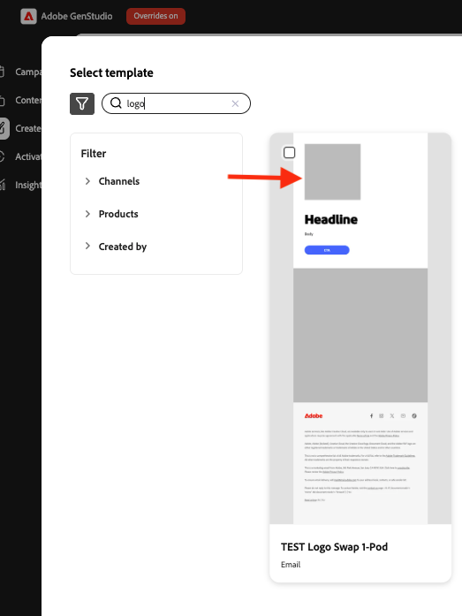
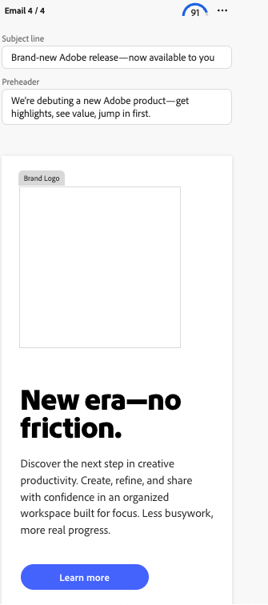

# Verwenden von Logo-Tausch in [!DNL Create]

Verwenden Sie den Logo-Tausch, um Markenlogos in Vorlagen während der Inhaltserstellung in [!DNL GenStudio for Performance Marketing] zu ersetzen.

## Voraussetzungen

- Richten Sie Vorlagen mithilfe des [Einrichtungshandbuchs für den Logo-](logo-swap-setup.md) ein. Das Symbol „Logo-Tausch“ wird nur für Vorlagen angezeigt, die die erforderlichen Logo-Platzhalter enthalten.
- Damit Logos während des **[!DNL Create]** Workflows austauschbar sind, müssen sie in **[!DNL Brands]** gespeichert sein.

## Austauschen eines Logos bei der Inhaltserstellung

1. Wählen Sie **[!DNL Create]** auf der Landingpage einen Kanal aus.
1. Wählen Sie eine Vorlage aus, die ein austauschbares Logo enthält. Die Vorlagenvorschau zeigt ein graues Platzhalterfeld an, in dem das Logo angezeigt wird.
   {width="300"}
1. Erstellen Sie Inhalte wie gewohnt. Vier Varianten werden angezeigt.
1. Bewegen Sie den Mauszeiger über den Logo-Bereich, um den Platzhalter anzuzeigen.
   {width="200"}
1. Klicken Sie im Bereich „Markenlogo“ auf **[!UICONTROL Aus Inhalt austauschen]**.
   {width="200"}
1. Wählen Sie im Bedienfeld „Markenlogo“ ein Logo aus und klicken Sie dann auf **[!UICONTROL Verwenden]**, um es auf die aktuelle Variante anzuwenden, oder **[!UICONTROL Auf alle Varianten anwenden]**, um es auf alle vier Varianten anzuwenden.
1. Sie können auch Logos nach Markennamen oder Filtern durchsuchen, um ein Logo zu finden.
   {width="300"}
1. Oder verwenden Sie eine Filtersuche, um ein Logo zu finden.
   {width="300"}
1. Fahren Sie bei erfolgreich ausgetauschtem Logo mit dem Workflow zur Inhaltserstellung fort (schließen Sie den Entwurf, den Export oder fordern Sie die Genehmigung an).

Logos können jederzeit wieder getauscht werden.

>[!NOTE]
>Wenn das Symbol für den Logo-Tausch nicht angezeigt wird, überprüfen Sie, ob die Vorlage für den Logo-Tausch konfiguriert ist und ob Logos in [!DNL Brands] verfügbar sind.
